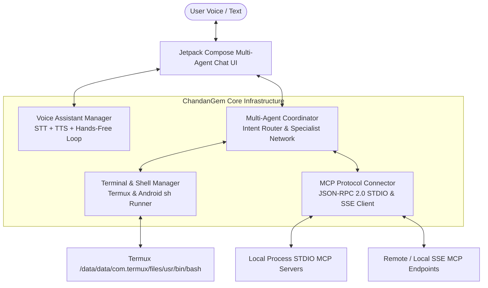
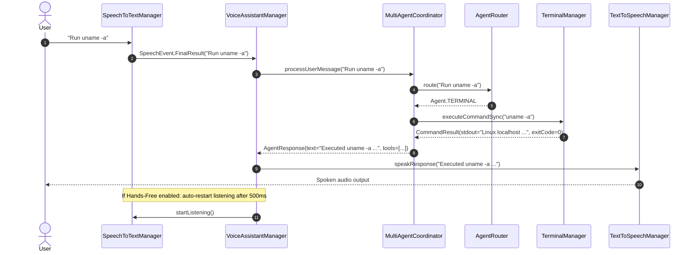

# Architecture Documentation: CodeNexus Application Suite

**Project Owner**: Chandan Kumar  
**Target Platform**: Android (minSdk 26, targetSdk 35) + Termux Linux Environment  
**Stack**: Kotlin 2.0, Jetpack Compose, Material 3, Kotlinx Coroutines & Serialization, Model Context Protocol (MCP)  

---

## 1. System Overview

**ChandanGem** is an autonomous AI agent application engineered natively for Android and the Termux environment. It unifies four core pillars into a single reactive architecture:



---

## 2. Architectural Pillars

### Pillar 1: Voice Assistant Module (Hands-Free Loop)
* **Speech-to-Text (STT)**: Wrapped around Android's `SpeechRecognizer` with `RecognitionListener` streaming partial transcriptions and audio amplitude (RMS dB).
* **Text-to-Speech (TTS)**: Built using `android.speech.tts.TextToSpeech` with coroutine suspension (`speakSuspend`) and utterance progress callbacks.
* **Hands-Free Conversational Loop**:
  - Automatically restarts STT when TTS finishes speaking (with a conversational pause of 500ms).
  - Supports **barge-in interruption**: speaking or tapping while the assistant is speaking immediately cancels the TTS engine and transfers state to `LISTENING`.
* **Waveform DSP (`AudioWaveformVisualizer`)**:
  - Clamps and normalizes raw RMS dB signals to `[0.05f..1.0f]`.
  - Applies rolling exponential smoothing (`0.7 * current + 0.3 * history`) across an 8-16 slot circular buffer to produce fluid animations in Jetpack Compose.

### Pillar 2: Terminal and Shell Execution Manager
* **Termux Environment Awareness (`TermuxEnvironment`)**:
  - Auto-detects `/data/data/com.termux/files/usr/bin/bash` or `sh`.
  - Configures appropriate environment variables (`PATH`, `PREFIX`, `HOME`, `TMPDIR`, `LD_LIBRARY_PATH`).
  - Gracefully falls back to `/system/bin/sh` in non-Termux Android runtimes.
* **Execution Engines**:
  - **Synchronous Execution (`executeCommandSync`)**: Executes commands within `ProcessBuilder` on `Dispatchers.IO`, buffers stdout/stderr, handles timeouts (default 60s), and returns structured `CommandResult`.
  - **Reactive Streaming (`executeCommand`)**: Emits live process stdout/stderr line-by-line via Kotlin `Flow<String>`.
  - **Interactive Sessions (`TerminalSession`)**: Manages long-lived shell processes with bidirectional stdin/stdout pipes, bounded scrollback history (1,000 lines), and process lifecycle termination.

### Pillar 3: MCP (Model Context Protocol) Client Connector
* **Protocol Standard**: Fully compliant with Anthropic/Open Model Context Protocol (MCP) JSON-RPC 2.0 specification (`2024-11-05`).
* **Data Models (`com.chandankumar.chandangem.core.mcp.model`)**:
  - `JsonRpcRequest`, `JsonRpcResponse`, `JsonRpcNotification`, `JsonRpcError`
  - `McpInitializeParams`, `McpInitializeResult`, `McpTool`, `CallToolParams`, `CallToolResult`, `McpResource`
* **Transports**:
  - **`StdioMcpTransport`**: Launches local executables (Node.js, Python, or shell scripts) via `ProcessBuilder` and communicates over standard input/output lines.
  - **`SseMcpTransport`**: Connects via Server-Sent Events (SSE) using OkHttp `EventSources` and transmits JSON-RPC requests via HTTP POST.
* **Unified Registry (`McpServerRegistry`)**:
  - Manages multiple concurrent server connections.
  - Exposes unified tool discovery and routing: any agent can invoke tools across all connected MCP servers seamlessly.

### Pillar 4: Multi-Agent Network & Chat UI
* **Agent Personas**:
  - **`Jarvis` (Lead Coordinator)**: Conversational orchestrator, routes queries and synthesizes final answers. (Color: Neon Cyan `#00E5FF`)
  - **`Shell Specialist`**: Terminal diagnostics and command generator. (Color: Emerald Green `#10B981`)
  - **`MCP Dispatcher`**: Tool execution and protocol interface. (Color: Cyber Purple `#A855F7`)
  - **`Code Architect`**: Android, Kotlin, and software architecture specialist. (Color: Amber `#F59E0B`)
* **Agent Router (`AgentRouter`)**:
  - Classifies user intent based on regex and semantic keywords (`run`, `exec`, `mcp`, `tool`, `compose`, `gradle`).
* **Jetpack Compose UI**:
  - **`ChatScreen`**: Main chat timeline with sticky audio visualizer bar.
  - **`MessageBubble`**: Custom bubbles with agent badges, collapsible `ToolExecutionCard` widgets, code block syntax styling, and TTS replay.
  - **`TerminalSheet`**: Modal bottom sheet providing a full-featured terminal emulator with multi-session tabs.
  - **`McpServerSheet`**: Modal bottom sheet for monitoring server health and running live tool tests.

---

## 3. Communication Sequences

### Voice Spoken Query to Tool Execution Loop



---

## 4. Source Tree Layout

```
chandangem-app/
├── gradle/
│   ├── libs.versions.toml             # Modern Gradle Version Catalog
│   └── wrapper/                       # Gradle 8.10.2 wrapper
├── build.gradle.kts                   # Top-level build config
├── settings.gradle.kts                # Subproject inclusions
├── gradle.properties                  # Performance flags
├── README.md                          # Getting Started & Setup Guide
├── ARCHITECTURE.md                    # Technical Architecture Specification
└── app/
    ├── build.gradle.kts               # Module build configuration (Compose, SDK 35)
    ├── proguard-rules.pro             # Proguard optimizations
    └── src/
        ├── main/
        │   ├── AndroidManifest.xml    # Permissions (Audio, Net, Foreground)
        │   ├── res/                   # Drawables, colors, strings, themes, xml configs
        │   └── java/com/chandankumar/chandangem/
        │       ├── ChandanGemApplication.kt
        │       ├── MainActivity.kt
        │       ├── core/
        │       │   ├── voice/         # STT, TTS, Hands-Free loop, Waveforms
        │       │   ├── terminal/      # ProcessBuilder, Termux, Sessions, Streams
        │       │   ├── mcp/           # JSON-RPC 2.0, Stdio & SSE Transports, Registry
        │       │   └── agent/         # Multi-Agent Coordinator & Intent Router
        │       └── ui/
        │           ├── theme/         # Color, Typography, Material 3 Theme
        │           ├── chat/          # ChatScreen, ViewModel, MessageBubble, InputBar
        │           ├── terminal/      # TerminalSheet & ViewModel
        │           └── mcp/           # McpServerSheet & ViewModel
        └── test/                      # Comprehensive Unit Test Suite
```

---

## 5. Security & Permission Considerations

1. **Microphone Access (`RECORD_AUDIO`)**:
   - Requested at runtime using Android's modern `ActivityResultContracts.RequestPermission()`.
   - Foreground service declaration for persistent hands-free audio loops.
2. **Localhost Socket Access**:
   - `network_security_config.xml` explicitly whitelists cleartext traffic for `localhost`, `127.0.0.1`, and emulator loops for local MCP servers without compromising remote SSL security.
3. **Shell Process Isolation**:
   - Processes are run under Termux uid/gid or application sandbox without requiring root.
